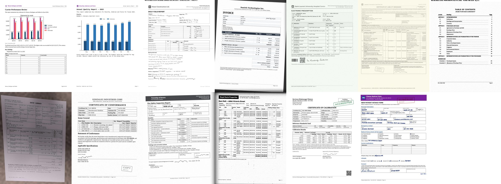

# cloudraker-synthdocs

OCR and document-layout training data across regulated industries, in French and English.

55,595 synthetic document pages from 9 regulated industries and 80 document types. Each page has exact ground truth: layout boxes, markdown per region in reading order, and tables in OTSL, HTML and markdown. About 30 % of the pages are in Canadian French. Pages go through 17 kinds of real-world damage: scans, faxes, phone photos, photocopies, crumpled paper, coffee stains, and more.



## Contents

| subset | pages | train | val | description |
|---|---:|---:|---:|---|
| `core` | 49,995 | 49,036 | 959 | 80 document types, all 17 degradation presets |
| `charts` | 2,300 | 2,000 | 300 | Reports with bar, line and pie charts, one doctype per industry |
| `styles` | 3,300 | 3,000 | 300 | Pages with varied visual themes (fonts, colors, layouts), light degradation |
| **total** | **55,595** | | | |

- Image: WebP, RGB, 1700 x 2200 px (US Letter at 200 DPI).
- Language: 37,907 English pages and 17,688 French (fr-CA) pages. Some English pages have bilingual labels.
- Size: about 12 GB.
- The `core` val split is a fixed 2 % hash split on the page id. The `charts` and `styles` subsets come with their own split.

### Industries and document types

| industry | doctypes |
|---|---|
| insurance | auto_declarations, certificate_of_insurance, claim_intake, fnol_fax, home_inspection, loss_run, renewal_notice, subrogation_demand |
| healthcare | claim_form, consult_note, discharge_summary, immunization_record, intake_form, lab_report, prescription, ramq_letter |
| legal | affidavit, bilingual_contract, contract_page, court_cover, demand_letter, exhibit_list, lease_schedule, nda, power_of_attorney, toc_page |
| financial_services | balance_sheet, bank_statement, credit_card_statement, invoice, kyc_form, loan_amortization, remittance_advice, tax_slip, wire_confirmation |
| real_estate | appraisal, closing_statement, condo_fee_statement, inspection_report, lease, listing_sheet, purchase_agreement, rent_roll, title_search |
| public_sector | ati_request, bid_tabulation, inspection_report, meeting_minutes, notice_letter, permit_application, tax_assessment, vital_certificate |
| manufacturing | bill_of_materials, calibration_certificate, certificate_of_conformance, inspection_report, material_test_report, nonconformance_report, packing_slip, safety_data_sheet, work_order_traveler |
| construction | certified_payroll, change_order, daily_field_report, g702_pay_application, g703_continuation_sheet, inspection_checklist, lien_waiver, rfi, spec_section, submittal_transmittal |
| logistics | bill_of_lading, certificate_of_origin, commercial_invoice, customs_declaration, delivery_receipt, freight_invoice, packing_list, proof_of_delivery, rate_confirmation |

The `charts` and `styles` subsets add a `chart_report` doctype in each industry.

### Degradation presets (`core`)

| preset | pages | what it looks like |
|---|---:|---|
| scan_300dpi | 7,506 | flatbed scan |
| photo_phone | 6,524 | phone photo: perspective, desk background, shadow, blur, JPEG |
| photocopy_gen3 | 4,485 | third-generation photocopy |
| scan_skewed | 4,472 | scan rotated 1 to 4 degrees |
| clean | 3,946 | no damage |
| fax_1bit | 3,926 | 1-bit fax at 204 x 98 dpi, with a fax header line |
| photo_blurry | 3,092 | soft-focus photo, body text stays legible |
| lowres_jpeg | 2,551 | low resolution, heavy JPEG compression |
| crumpled | 2,526 | creases and local warps (boxes approximate) |
| bleedthrough | 2,504 | ink from the back of the sheet shows through |
| dirty | 1,494 | dust, smudges, marks |
| fax_dither | 1,493 | dithered fax |
| fax_2bit | 1,492 | 2-bit grayscale fax |
| screenshot_moire | 1,489 | screen photo with moiré |
| coffee_stain | 1,025 | coffee rings and stains |
| dot_matrix | 983 | dot-matrix printer, ribbon fade |
| thermal | 487 | faded thermal paper |

The `charts` and `styles` subsets use clean, scan_300dpi, lowres_jpeg, photocopy_gen3 and screenshot_moire.

## Download

The repository holds the docs, manifest and samples. The pages are in tar shards on the [v1.0 release](https://github.com/cloudraker/cloudraker-synthdocs/releases/tag/v1.0): one shard per industry for `core` (1.1 to 1.5 GB each), plus one for `charts` and one for `styles`.

```sh
# all shards into ./data (needs the GitHub CLI)
scripts/download.sh

# only some shards
scripts/download.sh data core-legal core-healthcare charts
```

Or download a shard by hand from the release page and run `tar -xf`. `manifest/SHA256SUMS` has the checksums.

After extraction:

```
data/
  core/train/legal/nda/1007_000123.webp
  core/train/legal/nda/1007_000123.json
  ...
  charts/val/...
  styles/train/...
```

## Ground truth

Each `.json` file holds the page metadata and the annotations. Short version:

```json
{
  "id": "1010_000079",
  "industry": "real_estate",
  "doctype": "appraisal",
  "lang": "en",
  "preset": "screenshot_moire",
  "width": 1700, "height": 2200,
  "page_md": "full page markdown in reading order",
  "layout_1036": [{"bbox": [416, 49, 905, 103], "cat": "page_header"}],
  "regions": [{"id": "1010_000079_r0", "cat": "page_header", "bbox_px": [682, 103, 1485, 218], "md": "..."}],
  "tables": [{"id": "1010_000079_r2", "otsl": "<fcel>File No.<fcel>81-0984-OF<nl>...", "html": "...", "markdown": "..."}]
}
```

[SCHEMA.md](SCHEMA.md) gives all fields, the 16 region categories, the reading-order rules and the OTSL tokens.

To see the boxes on a page:

```sh
pip install pillow
python scripts/overlay.py samples/core_real_estate_rent_roll_1001_003663.json -o overlay.png
```

## Manifest

`manifest/pages.csv.gz` has one row per page: `id, subset, split, industry, doctype, lang, preset, styled, bbox_approx, n_regions, n_tables, shard, path`. Use it to select pages before you download, for example all French fax pages. `manifest/stats.json` has the counts per subset.

```python
import pandas as pd
m = pd.read_csv("manifest/pages.csv.gz")
fr_fax = m[(m.lang == "fr") & m.preset.str.startswith("fax")]
print(len(fr_fax), fr_fax.shard.unique())
```

## Uses

- Fine-tuning OCR and document-parsing models for page-to-markdown output.
- Layout detection (16 categories) on damaged pages.
- Table structure recognition (OTSL, HTML), including merged cells.
- French and English OCR on Canadian business documents.

## Limits

- All pages are synthetic. Text, numbers and layouts are realistic but generated. Use real documents to evaluate a model before you use it in production.
- All names, addresses, phone numbers, emails and account numbers are fake. They follow Canadian formats but do not refer to real people or organizations. Company and institution names are also fictional.
- Checkbox state is not in the markdown ground truth. Charts and images have a box but no transcription.
- On `crumpled` pages (`bbox_approx: true`), boxes can be off by a few pixels.
- All pages are US Letter, single page. There are no multi-page documents.

## License

[CC BY 4.0](LICENSE). You can use, share and change the data, also for commercial use, if you give credit to CloudRaker.

## Citation

```bibtex
@misc{cloudraker_synthdocs_2026,
  title  = {cloudraker-synthdocs: OCR training data across regulated industries, in French and English},
  author = {{CloudRaker}},
  year   = {2026},
  url    = {https://github.com/cloudraker/cloudraker-synthdocs}
}
```
